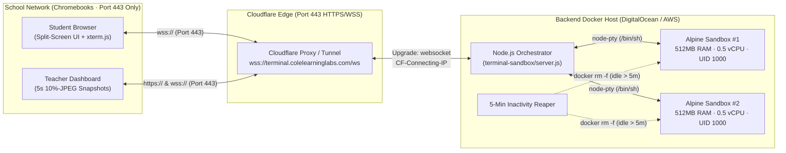

# Cole Learning Labs · Chromebook-Compatible Virtual Terminal Sandbox

An interactive browser-based Linux terminal (`xterm.js`) and Docker micro-environment orchestrator designed for **Grades 7–12** on locked-down **School Chromebooks**, tunneling all terminal PTY streams, self-paced milestone checks, and low-bandwidth teacher snapshots over a **single Port 443 Cloudflare WebSocket (`wss://`)**.

---

## 1. System Architecture Overview



---

## 2. Project Scaffolding Structure

```text
terminal-sandbox/
├── server.js                           # Backend API, Cloudflare WSS handshake, Docker+PTY spawner, 5m reaper
├── package.json                        # Backend service manifest (express, ws, node-pty, google-auth-library)
├── Dockerfile.sandbox                  # Unprivileged Alpine 3.20 student container image (UID 1000:1000)
├── Dockerfile                          # Node.js 24 orchestrator image with docker-cli & node-pty
├── docker-compose.yml                  # Orchestrator + Sandbox builder + optional cloudflared tunnel
├── cloudflare/
│   ├── nginx-cloudflare-ws.conf        # NGINX Port 443 SSL & WebSocket Upgrade proxy config for Cloudflare
│   └── cloudflared-config.yml          # Cloudflare Zero Trust Tunnel ingress config (outbound-only 443)
└── public/
    ├── index.html                      # Split-screen layout (Left: Self-Paced Sidebar, Right: xterm.js)
    ├── styles.css                      # Cole Learning Labs brand palette (--navy, --teal, --mint, --dark)
    └── app.js                          # xterm.js mount, WSS client, Markdown renderer, 5s 10%-JPEG snapshots
```

---

## 3. Core Architectural Constraints & Safeguards

1. **Zero Local Emulation on Chromebooks:**
   - 100% of shell execution and file inspection runs on the backend container host; the Chromebook only renders `xterm.js` and the Markdown sidebar.
2. **Strict Port 443 Tunneling Over Cloudflare WebSockets:**
   - School firewalls block SSH (`22`), RDP (`3389`), and VNC (`5900`).
   - All terminal `stdin`/`stdout`, window resizes, self-paced milestone verifications, instructor overrides, and 10%-JPEG screen snapshots multiplex over a single `wss://<host>/ws` connection on Port 443.
   - `server.js` sends a 30-second heartbeat (`ping`/`pong`) to keep the WebSocket alive across Cloudflare's 100-second idle proxy window.
3. **Aggressive Docker Container Isolation & 5-Minute Reaper:**
   - Each student session spawns an unprivileged Alpine container (`--user 1000:1000`, `--memory=512m`, `--memory-swap=512m`, `--cpus=0.5`, `--pids-limit=64`, `--cap-drop=ALL`, `--security-opt=no-new-privileges:true`, `--read-only`, `--network=none`).
   - An automated reaper checks session activity every 30 seconds and tears down any container idle for **5 minutes (`300,000ms`)** or upon WebSocket disconnect.
4. **Low-Bandwidth Teacher Dashboard (10%-Compressed JPEG Snapshots):**
   - Instead of streaming continuous video frames over shared school Wi-Fi, active student clients render a compact `640×360` canvas snapshot at `0.10` JPEG quality (`canvas.toDataURL('image/jpeg', 0.1)`) once every 5 seconds.

---

## 4. Quick Start (Local Development & Docker Production)

### Run Locally (Out-of-the-Box)
`server.js` runs immediately with Node.js `>=22.16.0` (automatically using Docker if the Docker daemon is running, or falling back to the built-in Alpine POSIX simulator if Docker is offline):

```bash
node terminal-sandbox/server.js
```
Then open `http://127.0.0.1:8080` in your browser.

### Build & Run with Docker Compose
```bash
cd terminal-sandbox
docker compose build
docker compose up -d
```
